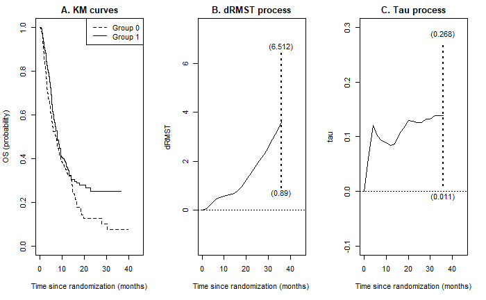

## Pseudo-IPD Reconstruction from Published Kaplan–Meier Curves under Unidentified Within-Interval Censoring
When individual patient data (IPD) are unavailable, researchers often reconstruct pseudo-IPD from the Kaplan–Meier curves and number-at-risk tables reported in clinical trial publications, most commonly with the algorithm of <a href="https://doi.org/10.1186/1471-2288-12-9" target="_blank"> Guyot et al. (2012) </a>. However, a reconstruction that reproduces the published curve well is not necessarily unique. Even after the event and censoring totals in each risk-table interval have been recovered, the published information does not determine how censoring is distributed within each interval. Different within-interval censoring placements can yield nearly identical Kaplan–Meier curves while implying different risk sets and censoring patterns, which may affect downstream analyses such as log-rank tests, Cox regression, restricted mean survival time, and IPCW-based procedures. We characterize this non-identifiability, quantify the number of censoring patterns compatible with the published constraints, and introduce a family of working censoring profiles that place censoring early, evenly, or late within each interval while preserving the reported numbers at risk. Simulation studies show that the sensitivity to censoring allocation increases as the risk table becomes coarser, and an application to the CheckMate 067 trial illustrates how the reconstructed censoring patterns can differ substantially even when the refitted survival curves are nearly indistinguishable. Rather than relying on a single reconstructed dataset, we recommend carrying multiple reconstructions through the same analysis as a practical way to assess reconstruction uncertainty.

## Leveraging Machine Learning for Covariate-Adjusted Causal Tau-Process Inference
In 2023, the U.S. Food and Drug Administration (FDA) issued guidance titled "<a href="https://www.fda.gov/regulatory-information/search-fda-guidance-documents/adjusting-covariates-randomized-clinical-trials-drugs-and-biological-products" target="_blank"> Adjustment for Covariates in Randomized Clinical Trials for Drugs and Biological Products </a>." This guidance recommends using prognostic baseline covariates to enhance the efficiency of estimating and testing marginal estimands. Traditionally, statistical practice involves selecting a "suitable" model and reporting the corresponding coefficients, whose meanings depend on the chosen model. However, no model is perfect, which can lead to significant bias and misleading interpretations. Alternatively, deriving the efficient influence function of the target estimand within a nonparametric model allows the use of machine learning techniques to approximate this function while still enabling valid statistical inference. Approaches such as Targeted Learning and Double/Debiased Machine Learning are based on this rationale. This framework shifts statistical methodology from a model-based approach to an estimand-oriented approach, effectively addressing scientific questions of interest and demonstrating the coherence of modern machine learning techniques with statistical methodology.

## Measuring Short-Term Treatment Effect under Mixed Cure Model
Due to the limited follow-up duration of trials or the nature of patients being cured, Kaplan-Meier curves often exhibit a long tail. The cured and uncured patients respond to treatments differently, and this distinction should be incorporated into the statistical inference procedure. The simplest model addressing this issue is the nonparametric mixed cure fraction model. Under this model, we derive a location-scale variant of the Kaplan-Meier estimator. This new estimator retains almost all of the desirable properties of the traditional Kaplan-Meier estimator, including the product-limit form, IPCW, and self-consistency. Consequently, the theoretical properties can be intuitively derived from classical results.

With a mixed cure fraction in the population, we aim to separate the heterogeneity of cured and uncured individuals and express the treatment effect for uncured patients using the tau-process framework. Our analysis, based on digitized clinical data, reveals some inconsistencies compared to pooled population results. This indicates the risk associated with classical methodologies. If we do not appropriately account for the cure fraction in the population, the analysis results may be misleading.

## Two-Sample Inference using Tau-Process under Nonproportional Hazards
In immunotherapy trials, survival curves for treated and control groups often exhibit delayed separation or crossing due to the human immune response. This phenomenon violates the traditional proportional hazards assumption in survival analysis, significantly reducing the power of standard testing procedures like the (weighted) log-rank test. Additionally, an addendum proposed by ICH suggests using an <a href="https://www.ema.europa.eu/en/ich-e9-statistical-principles-clinical-trials-scientific-guideline" target="_blank"> estimand framework </a> to report and interpret clinical trial results. Under nonproportional hazards, the commonly reported hazard ratio becomes meaningless. <a href=" http://www.oncoestimand.org" target="_blank"> Clinicians and biostatisticians in the pharmaceutical industry </a> are discussing a shift towards more interpretable treatment measures compared to the hazard ratio, log-rank test, and Cox model, in line with ICH guidance. We have proposed a novel approach for defining an interpretable estimand and developing the corresponding inference procedures. This methodology introduces a graphical Kendall's tau plot, effectively illustrating the relative performances of the two groups over time. The plot serves as an interpretable estimand for describing treatment effects and is advantageous because it is free of model assumptions and robust to censoring mechanisms.  

	

